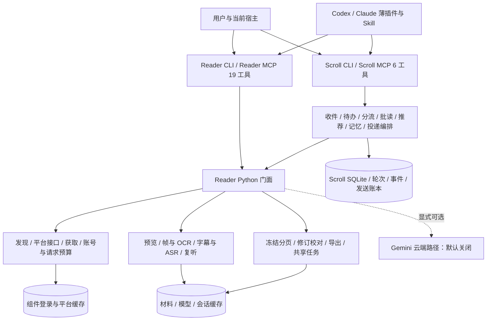

# Video Reader 整体架构与检查

身份：2026-11-04 修复前的工作区源码审查快照，包含未提交的状态、Inbox、队列及分流模块。不是已发布版本或纯 Git HEAD 架构。源码范围为 video_reader / scroll_agent 的 52 个 Python 文件，并核对启动器、配置、插件构建、操作契约和已有运行证据。

**总体分层成立，主要问题集中在边界上的配置、存储和默认成本耦合。** Reader 没有依赖个人推荐核心，Scroll 复用同一 Reader；新分流也没有再建读取核心。不过，收件、队列、记忆和缓存之间还缺少稳定的内部边界。下列问题不等于本批已经全部修复。

当前状态已由[架构修复](architecture.md)更新；本页保留原问题依据，源码链接的旧行号不再代表当前实现。

## 检查发现与优先顺序

| 优先级 | 问题及证据 | 影响与当前状态 |
|---|---|---|
| 高 | **身份解析混入联网。** [sources.resolve](../video_reader/sources.py#L42) 的 b23 分支直接 urlopen；[Reader.preview](../video_reader/reader.py#L140) 在 offline 平台构造前调用它 | 隔离模拟证实：离线短链预览仍先尝试一次网络调用，绕过平台预算/暂停通道。未修复；本次 6 条使用规范 BV，未触发。宜将纯身份解析与受控短链展开分开 |
| 高 | **默认打开与深检查成本绑定。** [Reader._open](../video_reader/reader.py#L261) 最后自动 read；[read](../video_reader/reader.py#L325) 的会话锁包含抽帧、时序文字/OCR 与语音核验；[Agent._deepen](../scroll_agent/agent.py#L412) 直接 open | 局部追问与重型准备争抢同一会话锁。11 月 3 日已有首条 open 1024.917 秒、补帧等锁 600 秒失败的证据。本批新 triage 走 preview 避开，默认深检查及锁粒度未改 |
| 中 | **收件配置借用投递配置。** [Scroll CLI](../scroll_agent/cli.py#L175)、[MCP](../scroll_agent/mcp_server.py#L119) 用 delivery.recipient_uid 初始化 Inbox | 将来只改发送对象也会改变允许同步的发送者。当前主号两角色一致；应分别配置并明确默认迁移关系，不能靠字段命名暗示同一职责 |
| 中 | **Inbox/Queue 存储边界交叉。** [Queue 初始化](../scroll_agent/queue.py#L60) 创建 Inbox 表；[Inbox](../scroll_agent/inbox.py#L98) 调用 Queue 的 _enqueue/_event/_parse_cursor/_decorate；Queue.show/history 又联查消息表 | 共用事务保证收件和入队一致，这个要求合理；私有方法和跨域建表使局部变更容易相互牵动。可保留同库事务，抽出表所有者及公开的事务内关联接口。未重构 |
| 中 | **已有材料提示依赖 Reader 私有缓存。** [Queue._decorate](../scroll_agent/queue.py#L259)、[Batch._cached](../scroll_agent/batch.py#L84) 扫描 v_*/manifest.json，理解 authentication/source 字段 | Reader 缓存布局变化会影响 Scroll；列表耗时随缓存数增长是源码推断，尚无性能基准。应提供公开材料查找接口；新 Triage 已使用 Reader API 和公开分片解码，未再增加该耦合 |
| 中 | **附言和要求仍共用 task。** [Queue](../scroll_agent/queue.py#L122) 与 Inbox 解析保留自由文本；[Triage.submit](../scroll_agent/triage.py) 才区分意图 | 容易把评价当要求。已在 assessment.intent 保存原文/comment/request/uncertain，并让明确要求等待用户；底层 intake 字段和旧流程尚未迁移。不能宣称全系统完成拆分 |
| 中 | **工作流契约散落。** Reader/Scroll CLI、两份 MCP 提示、源码 Skill 和宿主插件生成物分别维护 | 新 action 需手工同步多处；已确认“足以回答便及时回答”的目标仍与旧逐段校对指令有差距。宜先统一有效行为契约和少量接口一致性检查，保留 CLI 兼容桥，不必加大型框架 |
| 较低 | **业务记忆承担数据库基础设施。** [Memory.__init__](../scroll_agent/memory.py#L16) 为 queue/history 也初始化偏好、视频、轮次、投递和 FTS5/trigram；Queue/Triage 借 Memory.connect | 共用 SQLite 不是问题，基础连接与业务 schema 所有权才是耦合。可在需要独立收件部署时拆出连接层，当前没有数据损坏证据 |
| 较低 | **纯记录工具启动也经过 OCR 初始化。** [Scroll MCP.main](../scroll_agent/mcp_server.py#L213) 在 Windows、vision 开启时预导入 rapidocr | 仅查队列也触及可选视觉库；启动成本未测量，ImportError 已捕获，不能说缺 OCR 会使队列不可用。后续按需要分离初始化，同时保留 Windows 原生库初始化约束 |

本次修复了一个实际集成缺陷：长字幕预览采用 Reader 的 material_parts 格式，初版分流只理解普通字段，无法引用真实图片。现通过公开 restore 解码，补了分片不全拒绝、完整组装与证据提交测试。没有为此窥探缓存或复制读取算法。

另外保留两类已知限制，避免与本轮架构结论混淆：Qwen 强制中文退化尚未修复；历史 Windows 原子替换偶发失败仍须区分运行环境、占用与真实并发根因。本次相关 126 项在组件环境通过，不构成这两项的全局修复证明。

## 总体结构：谁负责什么

宿主是理解和语义校对的执行者。Reader 输出原生图片、带时间的文字和观察线索，不把取得材料等同于读懂。Scroll 管个人账号流与持久工作记录；普通视频问题直接用 Reader，无需先经过个人推荐、Inbox 或笔记流程。

部署是一个共享安装，两套独立 MCP 进程，另有显式后台 worker。薄插件提供工具连接和宿主行为说明，核心、模型、登录和缓存只有一套。旧 `run.ps1 agent ...` 经 video_reader.cli 延迟转发 Scroll CLI，是保留的兼容桥；Reader 核心没有反向导入 Scroll 的推荐实现。

## Reader 全部主要能力

| 层次 | 模块 | 数据和职责 |
|---|---|---|
| 入口与配置 | cli、mcp_server、common、defaults.json | 参数与错误、原生 MCP 图像/声音、配置合并、安装目录和本地模型缓存；入口把长任务转为共享 job |
| 来源与获取 | sources、bilibili_auth、youtube_auth、downloader_worker、acquisition_budget、platform | B 站 BV/分 P、YouTube、本地文件；组件扫码或用户导出 Cookie；yt-dlp 获取、元数据、平台字幕、媒体身份、账号作用域、缓存与请求预算/暂停 |
| 发现与轻预览 | discovery、uploader、preview | 通用主题检索、作品分页、候选、B 站原生分镜与字幕；p_ 冻结材料。预览不是完整媒体读取 |
| 视觉证据 | observation、vendor.frames、frame_detail、vision | FFmpeg/ffprobe 探测和取帧；uniform/adaptive/scene/dense；精确时点/裁剪；OCR、小字和时序稳定观察；保留来源与时间 |
| 语音证据 | speech、vendor.transcribe、qwen、qwen_pipeline/worker、recognition、relisten/worker、audio | 原生字幕优先、无字幕默认本地 Whisper；可选 Qwen 分窗/对齐；原文、可疑及未对齐候选、差异、复听和局部声音。ASR 不提供语义准确性担保 |
| 观众材料 | community、aligned_danmaku | 评论/楼中楼分页、按分 P 分段弹幕，按时间关联；弹幕默认关闭，观众言论保持独立来源 |
| 校对与交付 | review、delivery、mcp_content、export | 宿主提交校对与依据，原文/修订保全；reading/evidence/raw；冻结快照、文字/图像预算、游标、公开分片还原、绑定资产身份、指定修订导出 |
| 运行状态 | jobs、job_worker | CLI/MCP 共享 j_ 任务、短等待、独立 worker、阶段/心跳/进展、锁等待、结果与分页接续；查询不获取材料长锁 |
| 可选云端 | cloud、vendor.gemini | 显式启用的 Gemini 上传/原生 URL 问答与持久状态；默认关闭，无本地失败自动转云 |

完整读取先解析来源与账号，再获取或复用 v_ 会话。图像、字幕或 ASR 和观察结果经过冻结分页交付。宿主按任务理解和核查，再按需提交修订或导出。open 当前包含首轮 read，因此“打开”成本并不只是下载。

轻预览走另一条路径：受控平台请求 → 元数据/原生分镜/可用平台字幕 → p_ 冻结页 → 宿主观察。新 Triage 使用这条公开路径；没有新增 ASR 或语义模型。

## Scroll 全部工作流

| 领域 | 模块 | 当前行为 |
|---|---|---|
| 收件 | inbox | 显式同步已配置主号到组件小号；旧消息保留历史、新视频在同步时入队；分页提交消息/任务关联/游标，保留修订和失败，不发送回执 |
| 待办与历史 | queue | 优先级/FIFO、同来源不同要求分开、置顶/暂停/恢复/人工完成/取消/归档；原消息及事件可追溯；材料提示不等于已读 |
| 粗读建议 | triage | 显式 Reader 轻预览 → 宿主判断 → 校验并保存类型/意图/证据/方案；建议、待定和等待用户独立于队列生命周期；不执行方案 |
| 多片材料消费 | batch | 用户显式选择多片，逐页交付/确认/重放，失败隔离和单项重试；完成交付不表示读懂或校对完成 |
| 推荐和日试用 | agent、host | 首页或主题候选、偏好与历史、有限预览、宿主决策、可选有限深读、留档；已配置授权下才投递。host 适配外部宿主执行器，不是 Reader 的内置语义模型 |
| 个人记忆和账本 | memory | SQLite/FTS5 显式偏好与反馈、独立 observation、轮次与发送幂等/不确定状态；不从本轮测试猜测兴趣 |
| 运行和调度 | runtime、schedule、Windows tools 脚本 | 轮次 ownership/心跳/阶段/事件/恢复；旧日试用与可选 wake 的运行记录，规则以 daily-trial 为准。本批没有新增轮询或任务 |

现有 20:00 首页首条日试用、普通推荐和 Inbox 待办是不同入口。单轮 recover 复用原候选且只留档，不自动重新发送。收件队列尚无后台消费者；本次显式粗读也没有把它变成自动阅读服务。

Batch 与 Inbox 队列保留两套状态是合理的：前者跟踪“材料哪一页已交付/确认”，后者跟踪“用户有哪些待办”。同样，Reader job 与 Scroll round 分别属于处理任务和个人业务轮次，不能因都有 heartbeat 就强行合并。

## 数据、标识与一致性

| 存储 | 内容 | 不代表什么 |
|---|---|---|
| config.json、auth/ | 私有配置、组件登录、Cookie 导出快照 | 登录有效不等于模型额度充足 |
| data/preview/账号/ | 平台响应、预算/暂停、原生预览和联系表 | 有预览不等于全片已读 |
| data/cache/v_*/ | 媒体/来源身份、manifest、帧、语音、校对与导出相关材料 | 缓存存在不等于准确或宿主已观察 |
| data/cache/materials/p_*/、会话 delivery | 冻结预览/正文快照、游标和资产绑定 | 页已交付不等于宿主已读懂 |
| data/cache/_jobs/ | j_ 任务状态、执行者与结果 | 处理完成不等于结论可讨论 |
| data/agent/memory.sqlite3 | memories/FTS、videos、runs/run_events、deliveries、Inbox、queue、triage 当前记录和事件 | 人工 done 不等于 Reader/宿主完成 |
| data/agent/ 下轮次、批次、triage 锁及产物 | 候选、宿主输入输出、检查点、按领域归属的执行锁 | 有心跳不等于有业务进展 |

q_ 标识任务，im_ 标识消息；同一个 BV 可对应不同 q_ 要求。材料 p_/v_、处理 j_ 和业务 round_ 的身份不能互换。按组件账号隔离记录、冻结材料、绑定来源/分 P/时间和修订，是现有正确边界。

账号维护锁在 reader_profile 生成登录快照后释放，并非覆盖完整视频读取。不同于它，Reader 的会话材料锁确实包住重型读取，导致同会话补读等待。SQLite 每页事务用于保证消息、入队和游标一致；这些机制解决的冲突不同。

## 依赖、边界与后续重点

Python、FFmpeg、Node 按公共依赖管理；Python 主环境、可选 Qwen 环境、模型、缓存和登录归组件。Qwen 的既有 research 环境仍是当前真实运行资产，不能因目录名像实验而删除。首次安装、跨机和第三方宿主仍须单独验证。

默认本地、模型本地加载、Gemini 关闭。平台请求预算、本机算力、外部宿主额度是三类资源；当前没有可靠的统一额度调度。视频、字幕、网站链接和评论都是不可信材料，不会因为其中出现安装命令就自动执行。本轮动画教程的 Skill 安装文字已按此边界处理。

建议下一步先修短链接受控解析，再对默认准备深度与同会话锁做有目标的拆分；Inbox 配置及内部存储边界在下一次相关变更时处理。避免一次性重写 Reader、合并所有队列或新增通用编排框架。以上是审查建议，不视为新的持续实施授权。

## 验证范围

当前六条真实试跑：3 suggested、1 awaiting_user、2 undetermined；全部仍 pending，执行建议/发送为 0。分流测试覆盖请求优先、评论区别、类型待定、证据校验、快照/账号/陈旧判断、恢复复用、公开分页与分片组装。

组件 Python 环境下 126 项相关测试通过；新启动 Reader/Scroll MCP 确认为 19/6 个工具，六条结果一致，content 返回原生图片。未重跑全片 OCR/ASR 性能基准、未证明跨机安装或所有视频的语义准确率。短链缺陷复现使用模拟网络，真实联网次数为 0。

详细试跑与源码 SHA-256 索引见[本批验证](../validation/triage-architecture-20261104/report-source.md)；操作见[粗读分流参考](triage.md)。本页相对源码链接的行号仅对应本次工作区快照。
